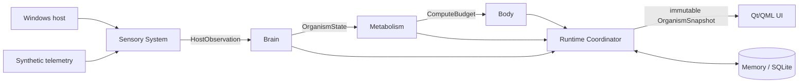

# Architecture

> Status: **proposed design**. Nothing here is implemented yet. Items marked *(proposed)* are not in the original report and need ratification in Phase 0.

## 1. Overview

PROMETHEUS is one desktop application with internal modules, not a distributed system. Five organism subsystems are coordinated by a runtime; Qt/QML only presents state.



Separation of concerns: **Sensors report facts → Brain selects behaviour → Metabolism assigns budgets → Body executes within them.**

## 2. Subsystem responsibilities

| Subsystem | Responsibilities | Must not own |
|---|---|---|
| Sensory | Collect/normalize host observations; validity and timestamps | Decisions, rendering |
| Brain | Update internal state; estimate pressure; choose behaviour/state | Windows handles, hardware polling |
| Metabolism | Compute budgets; pick quality tier; enforce hard limits and pacing | Visual design, persistence policy |
| Memory | Load/save identity, traits, events, checkpoints | Real-time simulation decisions |
| Body | Bounded simulation: movement, particles, morphology | Telemetry, DB access |
| Runtime coordinator | Lifecycle, scheduling, update order, snapshot publication | Biology rules, platform sensing |
| Qt/QML UI | Render snapshots, handle interaction | Mutable engine state |

## 3. The decision loop

Runs about once per second (initial value; tuned by profiling).

```
each decision interval:
    observation   = latest_valid_host_observation()          # stale → conservative fallback
    organism      = brain.update(observation, previous, dt)  # includes smoothed pressure
    proposed      = metabolism.calculate(observation, organism)
    safe          = enforce_hard_limits(proposed)
    if severe_pressure:  reduce_work_immediately(safe)       # degrade fast
    else:                restore_quality_gradually(safe)     # recover slowly
    body.update_within(safe)
    publish_immutable_snapshot()
    persist_if_required()
```

The Body simulation ticks on its own clock (about 10–30 Hz while active) using the **current** budget. The renderer draws the latest snapshot at its own capped rate (about 15–30 FPS while active). A rendered frame never forces a Brain or simulation update.

## 4. Clocks and initial rates

| Operation | Initial interval | Notes |
|---|---|---|
| CPU / RAM telemetry | ~1 s | CPU needs an interval between samples |
| GPU telemetry | ~2–5 s | Optional, NVML only |
| Brain / decision | ~1 s | |
| Simulation update | ~10–30 Hz active | Budget-controlled |
| Rendering | ~15–30 FPS active | Budget-controlled; event-driven when dormant |
| Persistence | On significant transitions + periodic checkpoint | Never per frame/sample |

These are starting parameters, **not validated requirements**.

## 5. Threading model *(proposed)*

| Thread | Owns | Notes |
|---|---|---|
| GUI thread | Qt objects, QML scene, ViewModel | Never blocks on telemetry, DB or simulation |
| Sensor worker | Sampling | One worker; mutex-protected latest-observation snapshot is sufficient for the MVP |
| Simulation thread | Brain, Metabolism, Body, Coordinator tick | Builds the immutable snapshot |
| Persistence worker | SQLite | Receives checkpoint requests via a bounded queue |

- Snapshot publication: simulation thread creates a `std::shared_ptr<const OrganismSnapshot>`; the GUI thread receives it via a queued signal or atomic swap. Lock-free queues only if profiling shows contention.
- Use `steady_clock` for all intervals; stamp observations so staleness can be detected.
- Simpler alternative for the first iteration: run the simulation tick on a worker `QTimer`/thread and add the persistence worker later. Decide in Phase 0.

## 6. Data contracts

Modules exchange small, explicit structs, never Win32 handles or mutable globals. See [interfaces.md](interfaces.md) for definitions, versioning and change control.

## 7. Compute budget and quality tiers

`Metabolism` is the key link between artificial-life mechanics and systems engineering. The Body **obeys** the budget; it never decides how much work to do.

| Tier | Name | Particles (illustrative) | Render | Behaviour |
|---|---|---|---|---|
| 0 | Dormant | 0–5 | 0–1 FPS / event-driven | Essential state only |
| 1 | Survival | 5–20 | 3–5 FPS | Minimal movement |
| 2 | Reduced | 20–60 | 8–12 FPS | Basic morphology |
| 3 | Normal | 60–150 | 15–20 FPS | Full basic simulation |
| 4 | Thriving | 150–300 | 24–30 FPS | Advanced visual behaviour |

All values are **untuned starting points**; tune against real measurements.

**Hard limits** (max particles, max update work, bounded queues, bounded memory, minimum safe scheduling interval) are enforced after any proposal and cannot be overridden by the Brain or any learned model.

**Asymmetry:** degrade immediately under severe pressure; restore one tier at a time with dwell times when conditions improve.

## 8. Dormancy

Dormancy is **not** hiding the window. Entering dormancy means:

- stop normal simulation updates;
- stop or event-drive rendering;
- reduce monitoring frequency where safe;
- save a checkpoint first;
- keep only the minimum lifecycle work needed to detect recovery or user intervention.

Wake when host conditions recover (with hysteresis) or the user explicitly resumes. Dormancy must be instrumented so tests and the benchmark can prove normal updates stopped. *(Proposed: the simulation thread parks on a condition variable with a timeout; the sensor worker slows to a low-frequency heartbeat.)*

## 9. Memory and persistence

| Layer | Contents | Storage |
|---|---|---|
| Working | Current variables, behaviour, recent observations | RAM (bounded) |
| Episodic | Significant events (sustained pressure, dormancy, recovery) | SQLite `events` |
| Long-term | Identity, generation, traits, adaptation, lifetime | SQLite `organism`, `traits` |

Policy:

- Load last valid checkpoint **before** simulation begins.
- Save before dormancy, on meaningful transitions, periodically, and on clean shutdown.
- Transactions + atomic checkpoint replace; versioned schema; recovery path for corrupt/incomplete state.
- DB work never on the render path. Store events and checkpoints, not every frame or sample.

Illustrative schema (versioned, to be finalized by Dev A):

```sql
CREATE TABLE schema_version (version INTEGER NOT NULL);
CREATE TABLE organism (
  id INTEGER PRIMARY KEY, generation INTEGER, age_seconds REAL,
  energy REAL, health REAL, stress REAL, curiosity REAL, adaptation REAL
);
CREATE TABLE traits (trait_name TEXT PRIMARY KEY, trait_value REAL);
CREATE TABLE events (id INTEGER PRIMARY KEY, timestamp INTEGER, event_type TEXT, description TEXT);
CREATE TABLE checkpoints (id INTEGER PRIMARY KEY, timestamp INTEGER, state_blob BLOB);
```

## 10. Body, rendering and Qt/QML

- Progression: QML shapes/Canvas → bounded C++ particle pool → `ShaderEffect` only when justified → custom C++ rendering only if profiling demands it.
- **Fixed-capacity particle pool:** activate/deactivate entries, no per-frame allocation. The active count follows the budget; allocated capacity does not change.
- Visual form reflects real state: active = fluid and more particles; stressed = contracted and slower; dormant = compact and nearly static.
- C++/QML boundary: a narrow `QObject` ViewModel with read-only `Q_PROPERTY`s and change notifications. QML never touches simulation objects or Windows handles.

## 11. Windows desktop integration

- Transparent, frameless window; configurable always-on-top; drag positioning; multi-monitor awareness.
- Optional click-through for non-interactive regions; interactive when the organism is selected. Do not make the whole window permanently click-through.
- Optional startup behaviour and user-controlled visibility.

## 12. Sensor failure behaviour

- Represent missing values with validity flags; never substitute zero.
- Continue core operation without NVML/GPU.
- Conservative fallback when critical telemetry is stale.
- Rate-limit sensor-failure logs.
- Test invalid, delayed and unavailable readings with synthetic telemetry.

## 13. Controller overhead

The controller must be cheaper than the work it controls: reuse observations, avoid per-tick allocation, no heavy inference in the critical loop, cap all workloads, make dormancy genuinely inexpensive.
